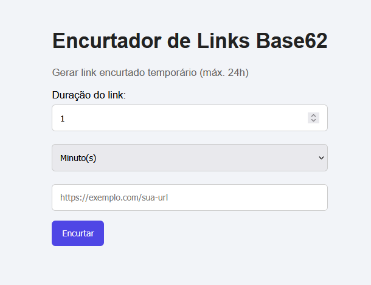

# Encurtador de Links Base62 (com Temporarizador)

Um projeto prático desenvolvido em **Node.js** para entender os fundamentos de como sistemas de encurtamento de URLs (como o Bitly) funcionam por baixo

## Demostração



## Alfabeto Base62

*0123456789abcdefghijklmnopqrstuvwxyzABCDEFGHIJKLMNOPQRSTUVWXYZ*

## Funcionalidades

* **Matemática Base62:** Utiliza um algoritmo de divisões sucessivas para converter IDs sequenciais chaves curtas. Por exemplo, para converter o ID 10000, o algoritmo realiza as divisões 10000 ÷ 62 = 161 (resto 18), 161 ÷ 62 = 2 (resto 37) e 2 ÷ 62 = 0 (resto 2). Para não ocorrem colisões duas URLs diferentes gerando o mesmo código curto.
* **Links Temporários (Snapchat):** Funcionalidade de "Temporarizador" onde os links gerados expiram automaticamente após 1 minuto. Após esse tempo, o sistema retorna um erro HTTP 410.
* **Redirecionamento Rápido:** Recebe a requisição do link curto e redireciona o usuário instantaneamente para a URL original longa.
* **Frontend Simples:** Interface limpa construída em HTML e CSS para testar a geração das URLs.

## Tecnologias Utilizadas

* **Backend:** Node.js com o framework Express.js
* **Frontend:** HTML5, CSS3, e JavaScript (Fetch API)
* **Armazenamento:** Array simples em tempo de execução

## Como testar localmente na sua máquina

1. Clone esse repositório

```bash
git clone https://github.com/estudos-ryan/LocalTempMail.git
```

2. Abra o projeto dentro da pasta do projeto e instale as dependências

```bash
npm i
```

3. Inicie o servidor:

```bash
node ./api/server.js
```

4. Acesse no seu navegador o endereço: `http://localhost:3000`

## Entendendo a Matemática (Por que Base62?)

Em vez de sortear letras aleatórias, o sistema salva a URL longa no banco de dados e verifica a qual "linha" ela pertence (seu ID). Esse ID (Base 10) é convertido para Base 62 (que possui 62 caracteres: `0-9`, `a-z`, `A-Z`).

* ID `1` vira a URL curta `/1`
* ID `10` vira a URL curta `/a`
* ID `61` vira a URL curta `/Z`
* Um ID como `10.000` vira a URL curta `/2Li` (Com apenas 3 caracteres é possível mapear mais de 238 mil links!).

---

## Atualização

* Validação de URL aprimorada.
* Adicionado `crypto-js` para geração aleatória das URLs.
* Adicionado `express-rate-limit` para limitar abusos na API por IP, permitindo a criação de até **20 URLs**.
* Adicionada seleção de tempo de expiração da URL, com limite de até **24 horas**.
